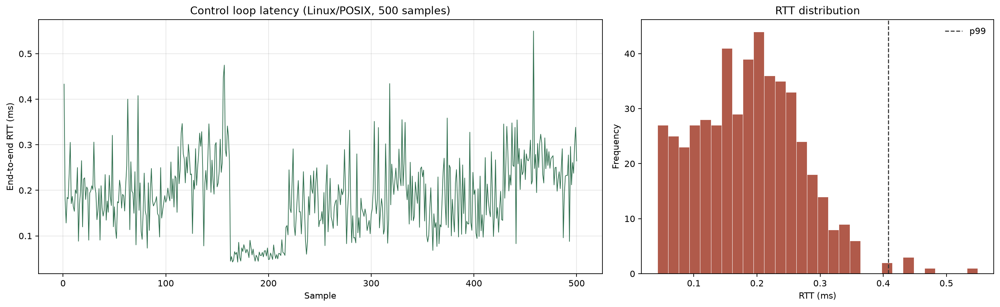
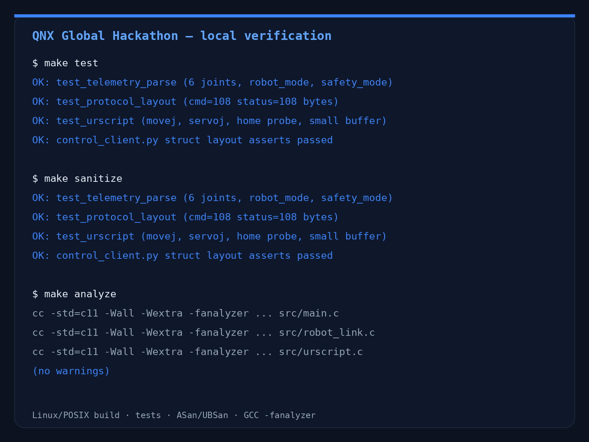
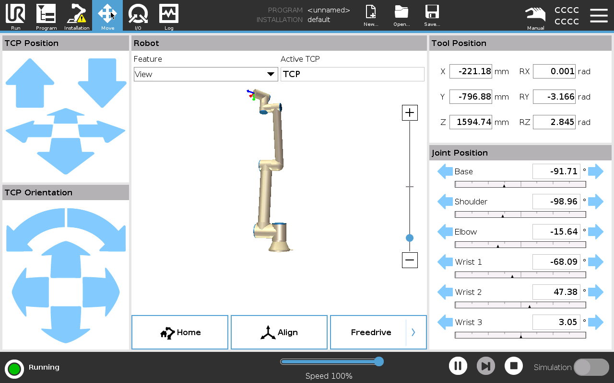
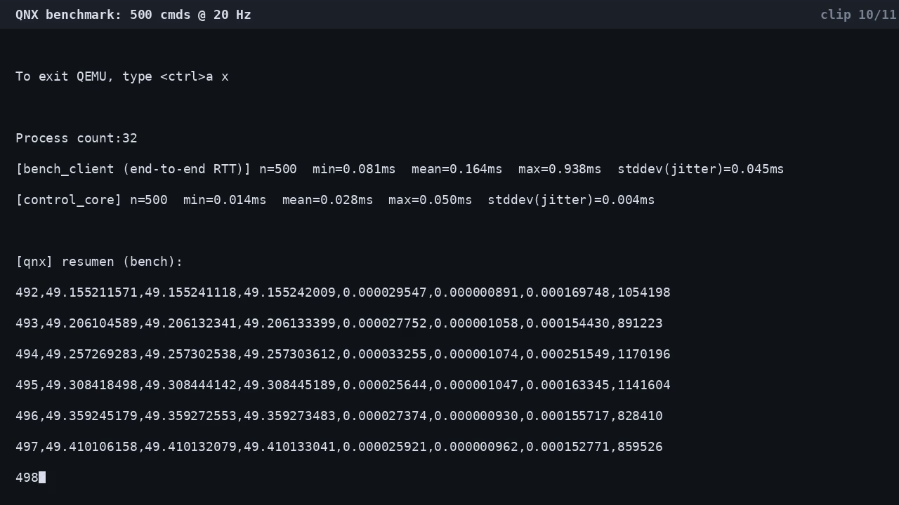
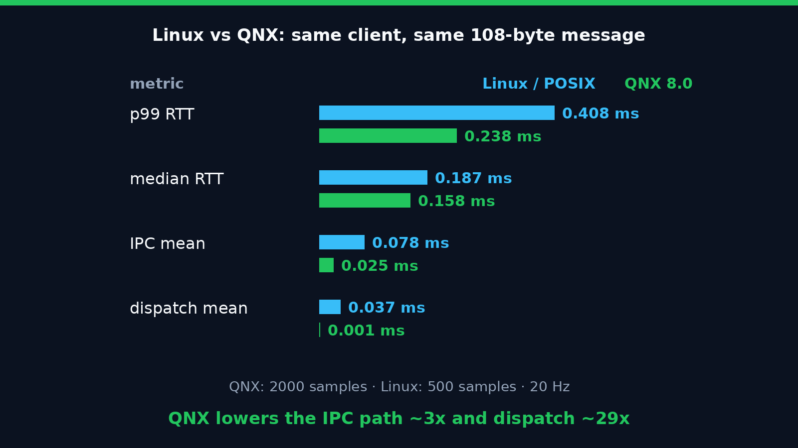

# QNX Robot Arm Control

**A hard-real-time control core for a UR20: a small, deterministic C loop that
owns the robot socket, isolated from the non-real-time vision stack and ported to
QNX Neutrino 8.0 with native message passing. Targets QEMU; no hardware
required.**

This repository contains the portable control core, the QNX
`MsgSend`/`MsgReceive` backend, the QNX build files, a QEMU harness and a
deterministic UR simulator, so the whole system can be built, run and measured
without buying a board or a robot.

> **Category:** **Robotics & Medical**.
>
> QNX 8.0 is free for non-commercial use (“QNX Everywhere”), and the hackathon
> explicitly accepts **QEMU** as a target. This repo is designed for exactly
> that: no purchase, no hardware, but a real QNX binary running under QEMU.

## Screenshots











## QNX verification status

- [x] QNX-specific source and build files are in the repo.
- [x] POSIX baseline, tests, sanitizers and static analyzer are green.
- [x] Real `qcc` build on QNX 8.0.
- [x] QNX boot in QEMU and benchmark CSV.
- [x] QNX screenshots and Linux vs QNX comparison.

Measured on QNX 8.0 (QSTI, QEMU x86_64, KVM) with the same `bench_client`
at 20 Hz: p99 RTT **0.238 ms** vs **0.408 ms** on Linux/POSIX, and IPC mean
**0.025 ms** vs **0.078 ms**. See [`results/README.md`](results/README.md) for
the full table and the honest QEMU limitation.

## Scalability

The same 108-byte protocol and the same control core work with URSim and with a
real UR20/UR e-series: only the robot IP changes. The QNX backend is a drop-in
replacement for the POSIX one, so the loop can move from QEMU to a physical QNX
board or an industrial PC without touching the vision stack. URSim is the bridge for
development and demos, not a different architecture.

---

## Why this project

A gesture-controlled robot has two very different halves:

1. **Vision** (Python + MediaPipe + webcam) — soft real-time; jitter is
   acceptable and a dropped frame is harmless.
2. **The control loop** — receives a joint target and writes it to the UR20
   socket on port 30003. Here latency and jitter matter: the loop must be
   isolated from garbage collection, UI, model inference and desktop scheduling.

This repository isolates (2) in a small C process with a fixed 108-byte binary
protocol, and ports it to QNX so the loop can run on a deterministic RTOS. The
vision process becomes an IPC client; it no longer touches the robot socket.

```
[vision: Python/MediaPipe, Linux] --vcr_cmd_msg_t (108 B)--> [control_core]
                                   <--vcr_status_msg_t-----      │
                                                                  └─ TCP 30003 → UR20
                                                               (or mock_ur_server)
```

## Vision integration (parallel work)

The vision half is **not** in this repository and does not run on QNX. It stays
in Python/MediaPipe on Linux, where dropped frames are harmless. This repo is the
QNX control half: the only owner of the robot socket.

For a deterministic end-to-end check without a camera, see
[`examples/vision_replay/`](examples/vision_replay/): it replays a recorded
joint-target sequence through `ControlCoreClient` and the same 108-byte protocol.
The boundary and the parallel work are documented in
[`docs/vision_integration.md`](docs/vision_integration.md).

## What is in this repository

| Path | What it is |
|---|---|
| `control_core/include/protocol.h` | Fixed 108-byte packed command/status protocol |
| `control_core/src/ipc_posix.c` | POSIX UNIX-socket backend (Linux baseline) |
| `control_core/src/ipc_qnx.c` | **QNX Neutrino native message-passing backend** |
| `control_core/src/robot_link.c` | TCP link to UR port 30003 + type-64 telemetry parser |
| `control_core/src/main.c` | Control loop, home probe, dry-run mode |
| `control_core/tools/bench_client.c` | Synthetic latency/jitter harness |
| `control_core/tests/` | Struct layout, telemetry-offset and URScript tests |
| `control_core/Makefile` | `make` (POSIX) and `make qnx` (`qcc`) |
| `qnx-emulator/` | QEMU launcher, QNX cross-build, bench script, mock UR server and URSim launcher |
| `results/` | Measured Linux and QNX results (CSV + plots) |
| `examples/vision_replay/` | Optional replay of recorded joint targets through `ControlCoreClient` |
| `docs/vision_integration.md` | Vision/control boundary, replay PoC and parallel work |

## URSim (optional visual demo)

The control core talks the same TCP 30003 protocol to a real UR controller or to
**URSim**, the official UR controller simulator. It is optional: the benchmark and
the video work without it.

```bash
./qnx-emulator/ursim.sh          # URSim UR20 in Docker (VNC + TCP 30003)
# open http://localhost:6080/vnc.html?host=localhost&port=6080
./control_core/build/control_core --robot-ip 127.0.0.1 --log /tmp/core_ursim.csv
```

The URSim type-64 telemetry is big-endian and uses different offsets from the
synthetic mock; `--with-telemetry` is only verified against the mock in this
repository (see the checklist).

## QNX target and toolchain

- **QNX version:** QNX SDP 8.0 / QNX Neutrino RTOS (QNX Everywhere, free
  non-commercial license).
- **Target:** QEMU x86_64 using the official **Quick Start Target Image
  (QSTI)** package `com.qnx.qnx800.quickstart.qemu`.
- **Toolchain:** `qcc -Vgcc_ntox86_64` (or `-Vgcc_ntoaarch64le` for ARM).
- **No hardware required:** QEMU is an explicitly supported target.

## Build and run

### A. Linux baseline (no QNX, no robot)

```bash
cd control_core
make clean && make
make test
```

This produces `build/control_core` and `build/bench_client`, and runs three
C test binaries: the 108-byte protocol layout, the type-64 telemetry parser and
the exact URScript strings (`movej`, `servoj`, `home probe`, small-buffer
rejection).

GitHub Actions runs the same POSIX build and tests on every push and pull request
(`.github/workflows/ci.yml`), plus AddressSanitizer/UndefinedBehaviorSanitizer
(`make -C control_core sanitize`) and GCC's static analyzer
(`make -C control_core analyze`). The QNX cross-build still needs the QSTI and
`qcc`, so it is documented and scripted but not run in CI.

Terminal 1 — deterministic UR simulator (no robot):

```bash
python3 qnx-emulator/mock_ur_server.py --host 127.0.0.1 --port 30003 --hz 20
```

Terminal 2 — control core against the simulator:

```bash
./control_core/build/control_core --robot-ip 127.0.0.1 \
  --endpoint /tmp/vcr_control.sock --with-telemetry --log results/linux_core.csv
```

Terminal 3 — benchmark:

```bash
./control_core/build/bench_client --endpoint /tmp/vcr_control.sock \
  --rate-hz 20 --count 500 --log results/linux_bench.csv
```

Or the one-shot harness:

```bash
./qnx-emulator/test-harness-linux.sh
```

### B. QNX 8.0 in QEMU (the submission target)

The QNX image is **free**; it only requires a myQNX account (no purchase).
Detailed steps: [`qnx-emulator/download-qnx.md`](qnx-emulator/download-qnx.md).

```bash
# 0) install QNX SDP 8.0 + package com.qnx.qnx800.quickstart.qemu from QSC
#    then: cd ~/qnx800/images/qemu && ./unpack_qemu_image.sh

# 1) cross-compile with qcc
export QNX_ENV=~/qnx800/qnxsdp-env.sh
./qnx-emulator/build-control-core.sh          # uses QNX_ARCH=x86_64 by default

# 2) boot QNX in QEMU (headless; no hardware)
QNX_SHARE_IF=ide ./qnx-emulator/run-qnx.sh

# 3) inside QNX: mount the shared FAT and benchmark
#    (the QSTI disk is hd0; the shared FAT is hd1t6)
ls /dev/hd*
mkdir -p /data/share
mount -t dos /dev/hd1t6 /data/share
cd /data/share && sh bench-inside-qnx.sh
```

The benchmark writes `bench_qnx.csv` and `core_qnx.csv`. Copy them back to
`results/` and compare with the Linux baseline (already done in this submission):

```bash
python3 compare_results.py
# -> tabla + results/linux_vs_qnx.png (Linux vs QNX)
```

## Why QEMU is a valid target (not a workaround)

The hackathon explicitly allows QEMU. For this project that is not a shortcut:
the component under test is the **OS-level control loop** (IPC, scheduling,
message passing, the fixed protocol), not a physical device driver. QEMU runs
the real QNX Neutrino kernel and the real `ipc_qnx.c` binary; the robot side is
a TCP endpoint, so a deterministic mock on port 30003 exercises the same
`robot_link.c` path without a UR20. The same binary can be rebuilt for a board
(`QNX_ARCH=aarch64le`) with no source changes.

## Threats to validity (honest)

- QEMU is not an RTOS on real hardware: absolute jitter is not a production
  figure. The comparison validates the port and the architecture.
- `mock_ur_server.py` is a test double, not a UR20; the URScript/telemetry
  parser is pinned by unit tests, but a real robot would add network and
  controller behaviour.
- The vision/MediaPipe half is intentionally out of scope for this repository;
  it is the soft-real-time producer that talks to this core.

## Results (reproducible)

**Linux/POSIX baseline** (this machine, 500 commands at 20 Hz, end-to-end RTT
from `bench_client`, including IPC + control core + mock robot socket):

| Metric | Value |
|---|---:|
| min | 0.042 ms |
| mean | 0.187 ms |
| median | 0.187 ms |
| p99 | 0.408 ms |
| max | 0.550 ms |
| stddev (jitter) | 0.083 ms |

Raw data: [`results/linux_bench.csv`](results/linux_bench.csv) and
[`results/linux_rtt_en.png`](results/linux_rtt_en.png).

**QNX/QEMU:** measured in this submission: 2000 commands at 20 Hz, p99
0.238 ms vs 0.408 ms on Linux, IPC mean 0.025 ms vs 0.078 ms. The comparison
is the point of the project: same client, same 108-byte message, same loop, two
OSes.

> Honest limitation: QEMU emulates the CPU and devices but is not an RTOS on
> real hardware, so the absolute jitter is not a production figure. The value is
> in validating the port, the native QNX IPC path and the architecture; a final
> production number would require a supported board (e.g. Raspberry Pi 5, also
> free to run QNX with QNX Everywhere).

## What is new in this repository

- New `src/ipc_qnx.c`: native QNX `name_attach` / `MsgReceive` / `MsgReply` /
  `MsgError` server and `name_open` / `MsgSend` client, same interface as the
  POSIX backend.
- New `make qnx` target with `qcc`, `QNX_ARCH=x86_64|aarch64le`, producing
  `control_core.qnx` and `bench_client.qnx`.
- New QEMU harness: QSTI launcher, shared-FAT deployment, in-VM benchmark.
- New deterministic `mock_ur_server.py` with type-64 telemetry, so no UR20 or
  URSim is needed.
- Tests that pin the 108-byte protocol and the type-64 offsets.

This work was created during the QNX hackathon submission period
(November 2026).

## License

MIT — see [`LICENSE`](LICENSE).

## Category

**Robotics & Medical**: a real-time control core for a UR20 where timing and
reliability are critical. This repository contains the QNX control core, build
files, instructions and docs.
