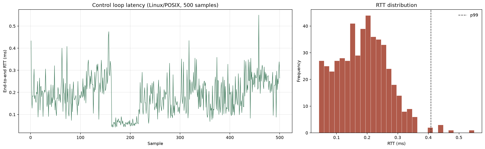
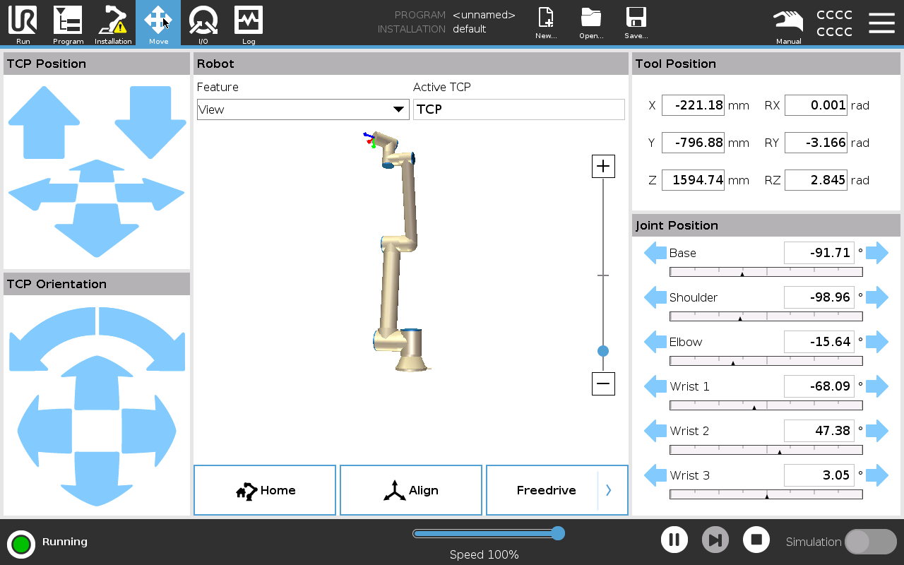
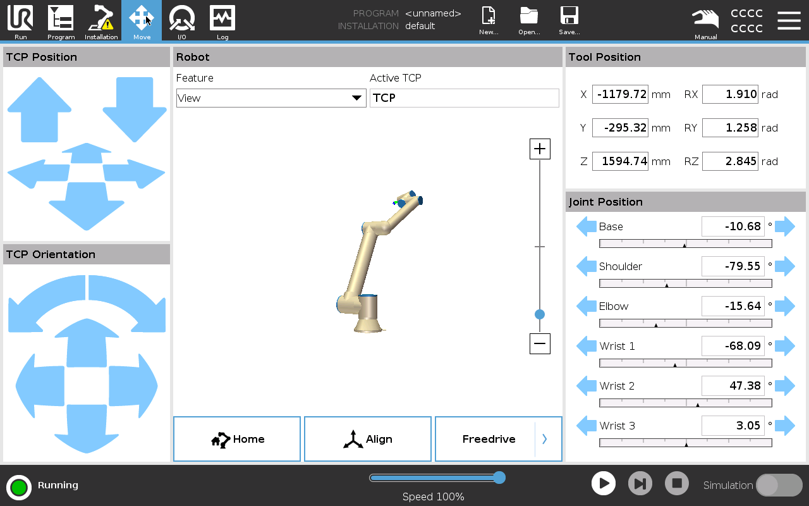
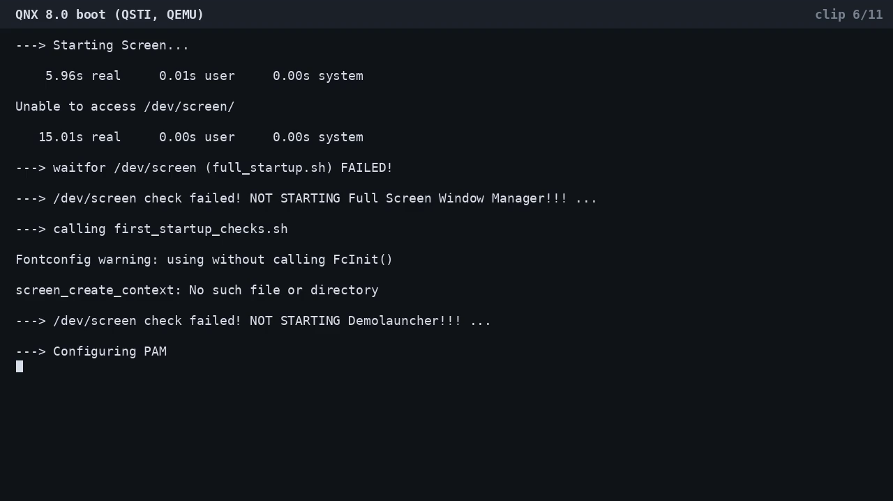
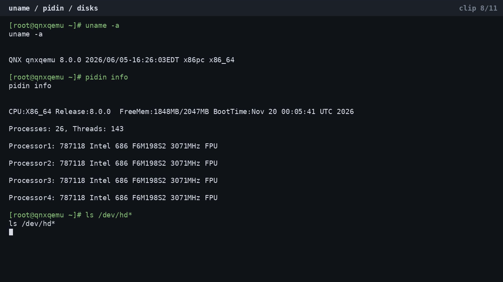
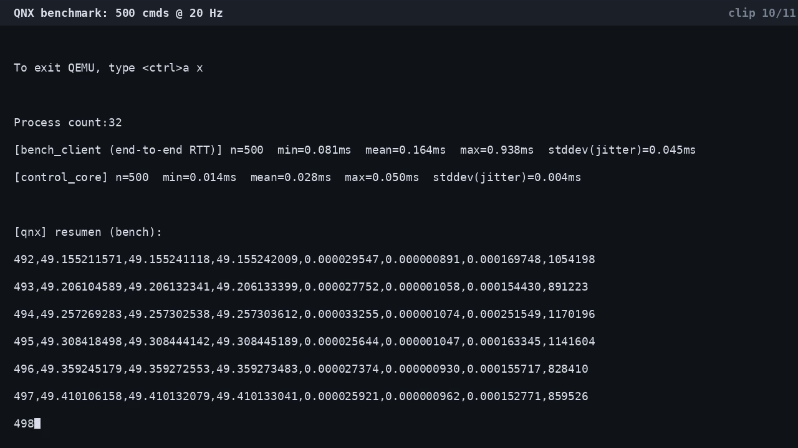
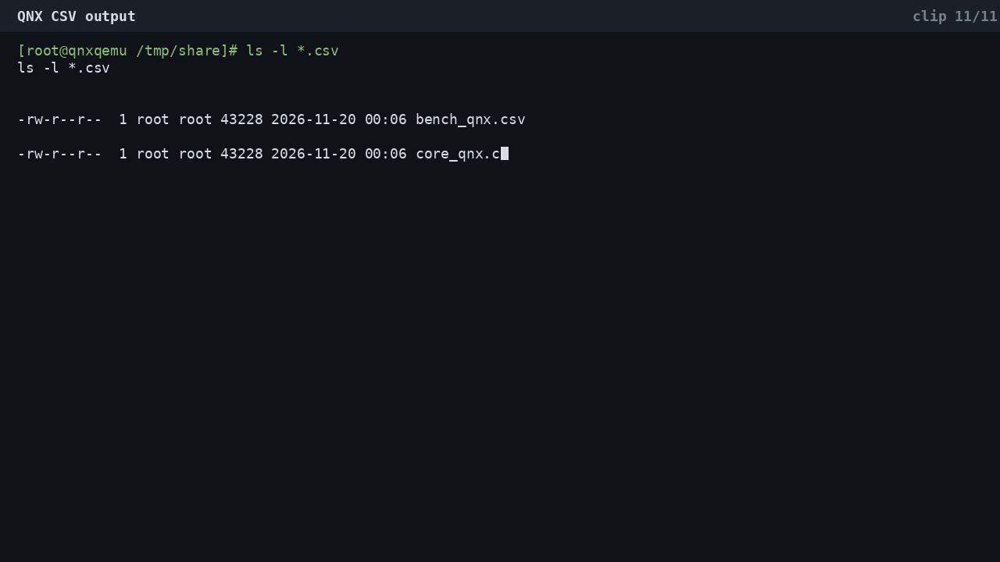
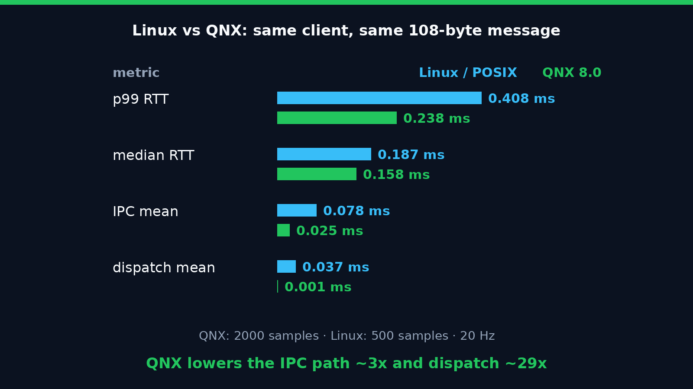

# Results

## Linux/POSIX baseline (measured)

`linux_bench.csv` — 500 synthetic commands at 20 Hz through
`control_core` + `mock_ur_server.py`, end-to-end RTT from `bench_client`.

| Metric | Value |
|---|---:|
| min | 0.042 ms |
| mean | 0.187 ms |
| median | 0.187 ms |
| p99 | 0.408 ms |
| max | 0.550 ms |
| stddev (jitter) | 0.083 ms |

`linux_core.csv` — the same samples as logged by `control_core` (IPC/dispatch
breakdown). `mock_ur.log` — commands received by the simulated UR20.

## QNX 8.0 / QEMU (measured)

QSTI for QEMU (x86_64, `-enable-kvm -cpu host`, 4 vCPUs, 2 GB), `control_core.qnx`
in dry-run with native `MsgSend`/`MsgReceive`/`MsgReply`, same 108-byte protocol
and the same `bench_client` at 20 Hz.

`qnx_bench.csv` — 2000 synthetic commands, end-to-end RTT from `bench_client`.

| Metric | Value |
|---|---:|
| min | 0.060 ms |
| mean | 0.181 ms |
| median | 0.158 ms |
| p99 | 0.238 ms |
| max | 20.235 ms |
| stddev (jitter) | 0.659 ms |

`qnx_core.csv` — the same samples as logged by `control_core.qnx`.

QNX screenshots:

### Linux vs QNX

| Metric | Linux/POSIX | QNX 8.0 (QEMU) |
|---|---:|---:|
| samples | 500 | 2000 |
| min | 0.042 ms | 0.060 ms |
| mean | 0.187 ms | 0.181 ms |
| median | 0.187 ms | 0.158 ms |
| p99 | 0.408 ms | 0.238 ms |
| stddev | 0.082 ms | 0.659 ms |
| IPC latency (mean) | 0.078 ms | 0.025 ms |
| dispatch latency (mean) | 0.037 ms | 0.001 ms |

QNX lowers the IPC path ~3x and dispatch ~29x versus the POSIX UNIX socket,
and p99 RTT drops from 0.408 ms to 0.238 ms. The QNX max/stddev are inflated by
4 outliers (seq 636, 766, 1714, 1750, up to 20.2 ms) in which the client-side
round trip stalls while the core timestamps stay at ~0.02 ms: that is QEMU/host
scheduling, not the Neutrino message path. Without those 4 samples: mean 0.171 ms,
p99 0.237 ms, max 0.401 ms. QEMU is not a real RTOS board, so the absolute
jitter is not a production figure; the comparison validates the port and the native
message-passing architecture.

Do **not** fabricate QNX numbers. If the QSTI cannot be downloaded, the honest
state is “Linux baseline measured; QNX port built and ready to run”, not a fake
comparison.
